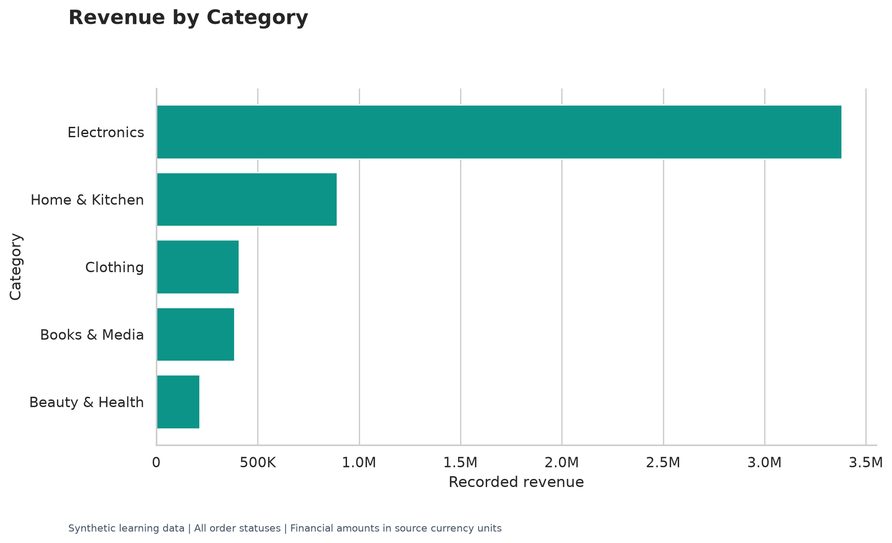
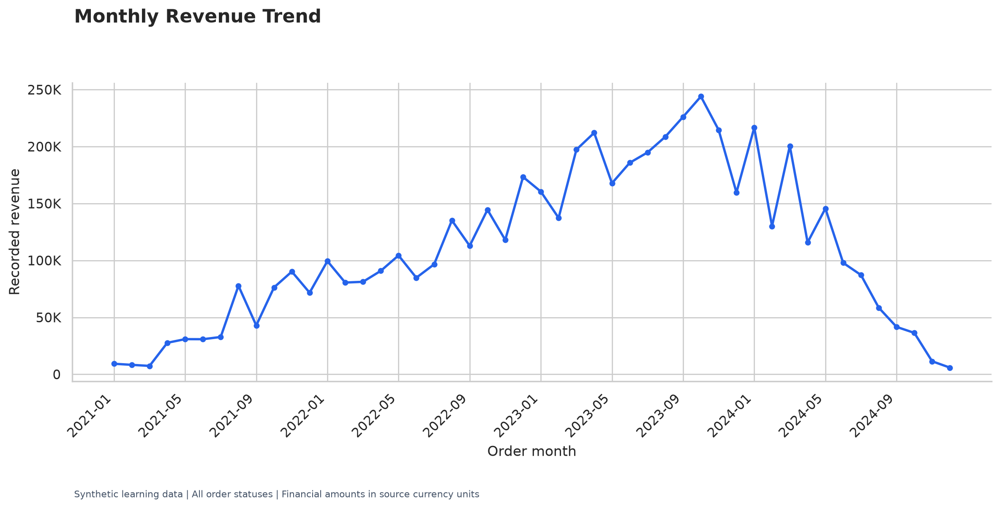
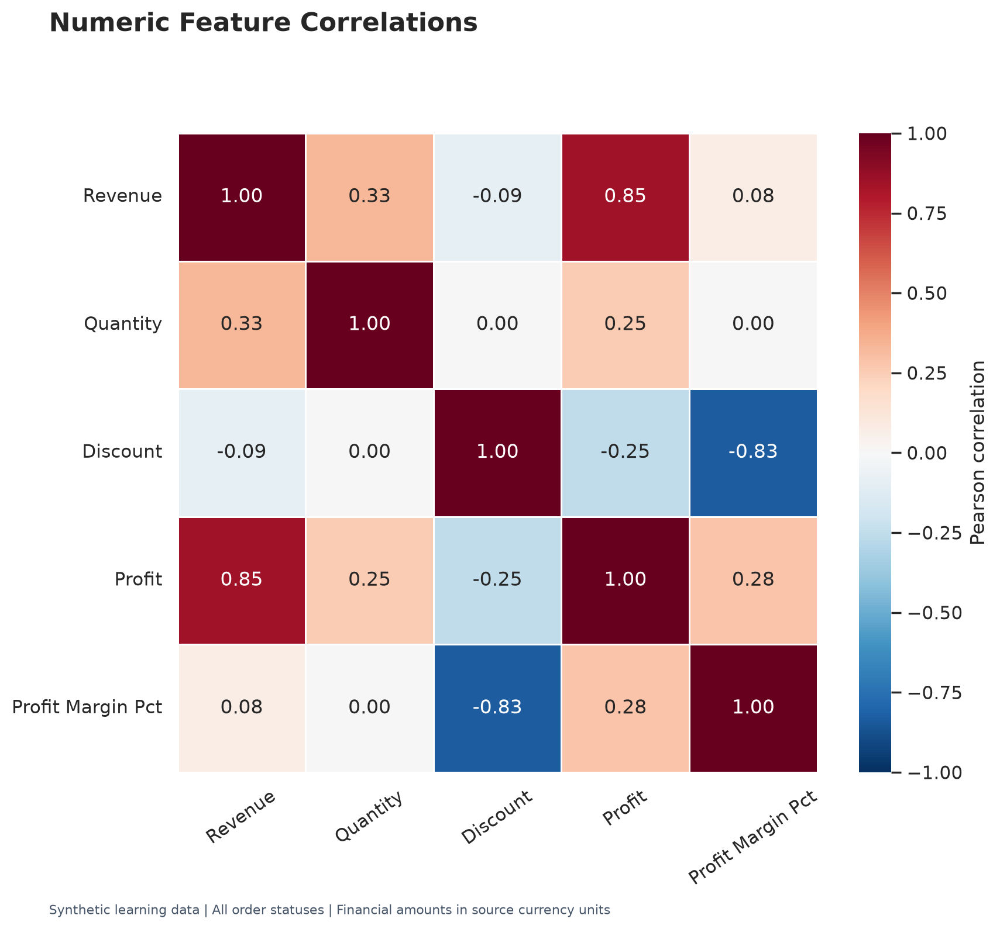

# E-Commerce Sales & Customer Analysis

An end-to-end Python exploratory data analysis project that converts
raw transaction data into business summaries, ten visualizations,
a cleaned dataset, and an automated PDF report.

**Author:** Gayatri Deshmukh

## Project Overview

This project explores sales performance, profitability, customer
contribution, regional trends, discounts, payment methods, and
order statuses.

The implementation includes reusable Python modules and an interactive
Jupyter Notebook.

## Workflow

Raw CSV → Inspection → Cleaning → Transformation → Analysis →
Visualizations → Business Insights → Cleaned CSV + PDF Report

## Technologies

- Python 3.11
- Pandas
- NumPy
- Matplotlib
- Seaborn
- ReportLab
- Jupyter Notebook

## Dataset

**Source:** [Global E-Commerce Sales Dataset | 2021–2024](https://www.kaggle.com/datasets/abdelfattahibrahim/global-e-commerce-sales-dataset-20212024)

The dataset contains **synthetic learning data**, not actual company
transactions.

| Attribute | Value |
|---|---:|
| Records | 10,000 |
| Unique orders | 10,000 |
| Unique customers | 5,348 |
| Products | 70 |
| Categories | 5 |
| Regions | 4 |
| Date range | 5 January 2021–24 December 2024 |

Customer names are unavailable; customer IDs are used instead.
Financial amounts are reported in source currency units.

Download the source CSV, place it in `data/raw/`, and rename it
`ecommerce_raw.csv`. Consult the source page for dataset usage terms.

## Business Questions

- Which regions and categories generate the most recorded revenue?
- Which categories contribute the most total profit?
- Which products and customers generate the highest revenue?
- How does recorded revenue change by month?
- What is the average order value?
- How are discounts associated with profit and profit margin?
- Which payment methods are used most frequently?
- How many distinct orders are cancelled or returned?
- Which products contribute the least total profit?

## Project Structure

| Path | Purpose |
|---|---|
| `data/raw/ecommerce_raw.csv` | Original input dataset |
| `data/processed/ecommerce_cleaned.csv` | Cleaned and transformed dataset |
| `src/config.py` | Paths, mappings, and assumptions |
| `src/data_loader.py` | Loading, header standardization, and inspection |
| `src/data_cleaning.py` | Cleaning and audit summary |
| `src/data_transformation.py` | Time fields and derived measures |
| `src/analysis.py` | KPIs, summary tables, and business insights |
| `src/visualization.py` | Ten saved charts |
| `src/report.py` | Automated PDF generation |
| `notebooks/ecommerce_eda.ipynb` | Interactive analysis and verification |
| `outputs/graphs/` | Chart images |
| `outputs/analysis/` | Summary CSVs and business insights |
| `outputs/reports/ecommerce_eda_report.pdf` | Final report |
| `main.py` | Complete pipeline entry point |

## Installation — Windows CMD

Open a terminal in the project root:

```cmd
py -3.11 -m venv .venv
.venv\Scripts\activate
python -m pip install -r requirements.txt
```

## Run the Project

Ensure the input CSV exists at:

```text
data/raw/ecommerce_raw.csv
```

Run:

```cmd
python main.py
```

The pipeline loads, cleans, transforms, and analyzes the data,
generates charts and the PDF report, saves the cleaned CSV,
and checks required output files.

Close the existing PDF viewer before rerunning if Windows prevents
the report from being replaced.

## Run the Notebook

1. Open `notebooks/ecommerce_eda.ipynb` in VS Code.
2. Select the project's `.venv` Python kernel.
3. Run all cells.
4. Save the notebook with its outputs.

The notebook reuses the project modules and checks that its business
measures agree with the cleaned CSV generated by `main.py`.

## Data Preparation

- Standardize source column names.
- Trim text and normalize known labels.
- Parse dates and convert numeric fields.
- Remove exact duplicates.
- Remove records missing essential transaction information.
- Validate sales, quantities, and discount rates.
- Retain negative profit values.
- Generate time fields, revenue, profit margin, and discount groups.

The inspected dataset required no row removals and retained all
10,000 records. Cleaning checks are still executed on every run.

## Metric Definitions

- **Revenue:** Sum of the source's recorded Revenue values.
- **Profit:** Sum of recorded Profit.
- **Unique orders:** Number of distinct Order IDs.
- **AOV:** Total revenue ÷ distinct orders.
- **Overall profit margin:** Total profit ÷ total revenue × 100.
- **Payment usage:** Distinct orders using each payment method.

Revenue already reflects discounts and quantity; neither is applied again.
A zero-revenue row has an undefined profit margin.

## Reporting Scope

The default financial analysis includes **all order statuses**:
Delivered, Processing, Cancelled, and Returned.

Recorded totals are therefore not delivered-only or refund-adjusted
results. Cancellation and return counts use distinct Order IDs across
all cleaned records.

`INCLUDE_ALL_ORDER_STATUSES` in `src/config.py` controls the financial
analysis scope.

## EDA Methods

- **Univariate:** Distributions, descriptive statistics, frequencies,
  missing values, and potential outliers.
- **Bivariate:** Regional/category revenue, customer contribution,
  monthly trends, and discount versus profit.
- **Multivariate:** Correlations among numeric business measures.

Potential outliers are investigated rather than automatically removed.

## Visualizations

1. Revenue by region
2. Revenue by category
3. Profit by category
4. Monthly revenue trend
5. Top 10 customers
6. Discount versus profit
7. Revenue distribution
8. Profit margin boxplot
9. Correlation heatmap
10. Payment method usage

### Selected Previews







## Results — All Statuses Included

| Metric | Value |
|---|---:|
| Recorded revenue | 5,284,387.70 |
| Recorded profit | 1,437,638.31 |
| Unique orders | 10,000 |
| Average order value | 528.44 |
| Overall profit margin | 27.21% |
| Cancelled orders | 908 |
| Returned orders | 1,857 |

### Key Findings

- Electronics leads recorded revenue and total profit.
- Middle East generates the highest recorded regional revenue.
- October 2023 has the highest recorded monthly revenue.
- Debit Card is the most-used payment method.
- Revenue is strongly right-skewed.
- Discount and row profit margin have a correlation of approximately −0.83.

These findings describe this synthetic dataset. Correlation does not
establish causation, and shared financial formulas can influence
observed relationships.

The late-period revenue decline needs investigation into monthly
order counts and dataset coverage before proposing a business explanation.

## Outputs

- Cleaned and transformed CSV
- Grouped analysis tables
- Business insights text file
- Ten PNG charts
- PDF analysis report
- Executable Jupyter Notebook

[Open the PDF Report](outputs/reports/ecommerce_eda_report.pdf)

## Validation

- Grouped revenue totals reconcile with headline revenue.
- Saved CSV row count matches the transformed dataset.
- Required output files are checked for existence and nonzero size.
- Notebook business measures are compared with the saved CSV.
- Generated charts and PDF pages were visually reviewed.

## Limitations

- Data is synthetic.
- Customer names and cancellation/return reasons are unavailable.
- Recorded profit does not establish inclusion of every operating expense,
  tax, or refund.
- Missing profit/discount cells are filled with zero under a documented
  instructor assumption; no such fills were needed for this dataset.
- Low total profit does not necessarily mean a product is loss-making.
- Results should not be generalized to actual businesses or markets.